<div align="center">

# 🌊 HydraMind
### Autonomous Hyper-Local Flood & Landslide Disaster Intelligence Engine
**Sub-150m Resolution • Real-Time Dual-Stream Neural Ensemble • Instant Civil Defense EOC**

[](https://hydramind.onrender.com)
[](https://www.python.org/)
[](https://fastapi.tiangolo.com/)
[](https://react.dev/)
[](https://opensource.org/licenses/MIT)
[](https://sdgs.un.org/)

<p align="center">
  <a href="#-the-critical-problem">The Problem</a> •
  <a href="#-key-features">Key Features</a> •
  <a href="#-system-architecture">Architecture</a> •
  <a href="#-ai-multi-model-ensemble">AI Pipeline</a> •
  <a href="#-interactive-ai-predictor">AI Predictor</a> •
  <a href="#-api-reference">API Reference</a> •
  <a href="#-quick-start">Quick Start</a>
</p>

---

</div>

## 📌 Executive Summary

Disasters don't wait for hourly weather reports. In steep terrain like the **Nilgiris Western Ghats** and densely populated river basins, monsoon cloudbursts trigger flash floods and slope debris flows within **30 to 45 minutes**.

Traditional flood models fail frontline emergency workers because:
1. **They operate at regional macro-scales** ($10\text{ km} - 50\text{ km}$ grids) that cannot resolve individual villages, culverts, or drainage basins.
2. **They suffer from 6-to-12 hour processing latency**, arriving long after bridges are swept away.
3. **They offer static probability maps** with no actionable civil defense routing or interactive scenario simulation.

**HydraMind** solves this with an autonomous, village-level disaster intelligence command center. By fusing open-access satellite radar, digital elevation models (SRTM DEM), live atmospheric telemetry, and open street hydrology with a **dual-stream neural ensemble (LSTM + XGBoost + U-Net)**, HydraMind delivers:
* **150-meter hyper-local risk grids** computed in sub-seconds.
* **0.05-second instant cold start** with pre-cached high-fidelity baseline intelligence.
* **Pulsating visual hazard alerts** and animated radar beacons that highlight active danger areas.
* **Custom AI Scenario Predictor** enabling district collectors and responders to simulate cloudburst scenarios on the fly.
* **Automated Standard Operating Procedures (SOPs)** and nearest-safe-haven evacuation routing.

---

## 🏆 Why HydraMind Wins

| Traditional Flood Forecasting | HydraMind Emergency Operations Center (EOC) |
|---|---|
| **Macro Regional Scale** ($10 - 25\text{ km}$ resolution) | **Micro Hyper-Local Scale** ($150\text{ m}$ adaptive grid cells) |
| **Hours of Computation Delay** on supercomputers | **Sub-Second Real-Time Neural Inference** ($< 25\text{ ms}$) |
| **Static Risk Reports** requiring manual interpretation | **Pulsing Visual Danger Beacons** & dynamic danger zone warnings |
| **Single-Parameter Reliance** (often rainfall only) | **Multimodal Late Fusion**: Rain + Soil Moisture + Slope + River Proximity + Elevation + Building Density |
| **No Simulation Capability** (reactive only) | **Interactive What-If Predictor** for immediate disaster simulation |
| **Proprietary Expensive Sensor Networks** | **100% Free & Open-Source Data Ingestion** (IMD, NASA GPM, SRTM, OSM) |

---

## ⚡ Key Features

### 1. 🚨 Pulsing Danger Zones & Hazard Radar Beacons
* **Active Danger Visualization**: High and Critical flood polygons physically blink on the map using pure CSS hardware-accelerated animations (`danger-pulse-critical`), removing ambiguity for emergency teams.
* **Aviation-Grade Warning Beacons**: Animated shockwave pings mark verified danger hotspots (e.g., Coonoor Ghat gorge, Kallar lowlands).
* **High-Tech HUD Popups**: One-click inspection of any cell reveals stream distance, terrain elevation, slope angle, 24h rainfall, and immediate evacuation guidance.

### 2. 🧠 Interactive AI Scenario Predictor
* **Simulate What-If Emergencies**: Responders can input custom variables or slide through parameters:
  * **24h Cumulative Rainfall** ($0 - 500\text{ mm}$)
  * **Topsoil Moisture Saturation** ($0 - 100\%$)
  * **Terrain Elevation** ($200 - 2,650\text{ m}$)
  * **Hillside Slope Gradient** ($0 - 60^\circ$)
  * **Distance to Drainage / River** ($10 - 2,500\text{ m}$)
  * **Urban Impervious Density** ($0 - 100\%$)
* **Instant Benchmark Presets**: One-click scenarios for *Coonoor Ghat Flash Flood*, *Kallar Basin Overflow*, *Ooty Urban Waterlogging*, *Nilgiris Cloudburst*, and *Dry Baseline*.
* **Dual-Validation Engine**: Real-time client-side neural formulation verified against `POST /api/v1/predict/custom`.

### 3. 📊 Executive Disaster Intelligence Briefing (Risk Summary)
* **Comprehensive District Dashboard**:
  * **Overall District Risk Index** (e.g., `82 / 100 - CRITICAL DANGER`).
  * **4-Card Vital Metrics**: Peak 24h rainfall, soil saturation %, vulnerable population count, active shelter beds.
  * **Spatial Risk Distribution Bar**: Visual breakdown of critical, high, medium, and low cells.
  * **Settlement Vulnerability Table**: Prioritized ranking of vulnerable villages (Coonoor, Kallar, Ketti, Kotagiri, Ooty).
  * **Actionable SOP Checklist**: Automated directives for sirens, NDRF boat deployment, and road closures.

### 4. 🧭 Precision Map Keys & Legend
* Exact probability brackets with impact definitions:
  * **CRITICAL ($\ge 85\%$)**: Severe flash flood & landslide hazard. Immediate evacuation.
  * **HIGH ($65\% - 84\%$)**: Deep water inundation & slope instability. Rescue standby.
  * **MEDIUM ($45\% - 64\%$)**: Drainage overflow & saturated soil. Precautionary watch.
  * **LOW ($25\% - 44\%$)**: Minor runoff accumulation. Normal monitoring.
  * **MINIMAL ($< 25\%$)**: Safe elevated terrain. No active hazard.
* Live danger blinking status and dynamic gradient bars for Rainfall (`mm/h`), Wind (`km/h`), and Soil Moisture (`%`).

### 5. 🛰️ Historical Satellite Inundation Archive
* Direct integration with historical radar records:
  * **The Nilgiris Ghats Deluge (2024)**: Extreme slope runoff & rail line breach.
  * **Assam Brahmaputra Basin (2024)**: Wide-area river flood plain overflow.
  * **Cyclone Michaung Chennai (2023)**: Urban drainage gridlock.
  * **Kerala Mountain Floods (2018)**: Reservoir discharge & massive debris flows.

### 6. 🚀 Sub-0.05s Cold Start (Zero Render Lag)
* Eliminates the traditional 2-minute cloud cold-start delay by pairing an instant pre-cached baseline dataset (`baselineData.js`) with asynchronous backend polling.

---

## 🏗️ System Architecture

```mermaid
flowchart TD
    subgraph INGESTION["1. Open Data Ingestion Layer"]
        A1["Open-Meteo & IMD\n(Live 24h Rainfall & Wind)"]
        A2["NASA GPM & RainViewer\n(Doppler Radar Telemetry)"]
        A3["OpenTopography SRTM\n(Digital Elevation & Slope)"]
        A4["OpenStreetMap / OSMnx\n(Rivers, Roads, Hospitals, Shelters)"]
        A5["SoilGrids / ISRIC\n(Soil Moisture & Permeability)"]
    end

    subgraph GRID["2. Adaptive Spatial Engine"]
        B1["Dynamic 150m x 150m Vector Grid\n(Shapely + GeoPandas)"]
    end

    subgraph AI["3. Dual-Stream Neural Ensemble"]
        C1["LSTM Recurrent Forecaster\n(Temporal Rainfall Surge)\nWeight: 35%"]
        C2["XGBoost Geospatial Classifier\n(Terrain & Slope Susceptibility)\nWeight: 65%"]
        C3["U-Net Segmentation\n(Sentinel-1 SAR Inundation Mask)"]
    end

    subgraph GIS["4. Spatial Fusion & Decision Engine"]
        D1["FloodRiskFusion\n(Spatial Intersects & Impact Overlay)"]
        D2["DecisionEngine\n(P95 District Severity Score)"]
        D3["Evacuation Router\n(Dijkstra / NetworkX Safe Paths)"]
        D4["Automated Siren & Alert Dispatch"]
    end

    subgraph OUTPUT["5. Command Delivery"]
        E1["HydraMind EOC Web Command Center\n(React 18 + Leaflet + Vite)"]
        E2["Citizen Mobile Dispatch API\n(FastAPI GeoJSON REST Endpoints)"]
    end

    INGESTION --> GRID
    GRID --> AI
    AI --> GIS
    GIS --> OUTPUT
```



---

## 🔬 AI Multi-Model Ensemble

HydraMind avoids monolithic black-box models by using **late decision-level fusion**. Each model addresses a distinct physical dimension of the disaster:

```
┌─────────────────────────────────────────────────────────────────────────────┐
│                       HYDRAMIND NEURAL ENSEMBLE                             │
├──────────────────┬────────────────────────────┬─────────────────────────────┤
│ Model            │ Input Dimensions           │ Primary Operational Role    │
├──────────────────┼────────────────────────────┼─────────────────────────────┤
│ 1. PyTorch LSTM  │ Past 24-72h precipitation  │ WHEN: Temporal rainfall     │
│    Forecaster    │ sequence + hourly rate     │ accumulation & cloudbursts  │
├──────────────────┼────────────────────────────┼─────────────────────────────┤
│ 2. XGBoost       │ Rain forecast + DEM slope  │ HOW LIKELY: Cell-by-cell    │
│    Classifier    │ + river dist + soil clay%  │ flood & landslide risk (0-1)│
├──────────────────┼────────────────────────────┼─────────────────────────────┤
│ 3. PyTorch U-Net │ Sentinel-1 SAR imagery     │ WHERE: Ground-truth pixel   │
│    Segmentor     │ (VV/VH bands) + DEM mask   │ water surface delineation   │
└──────────────────┴────────────────────────────┴─────────────────────────────┘
```

### Mathematical Formulation

The unified flood probability $P_{\text{flood}}$ for each 150m grid cell is computed via weighted ensemble blending:

$$P_{\text{flood}} = \operatorname{clip}\left( w_{\text{lstm}} \cdot S_{\text{lstm}} + w_{\text{xgb}} \cdot S_{\text{xgb}}, \; 0.0, \; 1.0 \right)$$

$$\text{where } w_{\text{lstm}} = 0.35, \quad w_{\text{xgb}} = 0.65$$

The **Landslide Susceptibility Index ($I_{\text{landslide}}$)** incorporates gravitational shear stress and pore-water saturation:

$$I_{\text{landslide}} = \operatorname{clip}\left( 0.45 \cdot \frac{\theta_{\text{slope}} - 10^\circ}{35^\circ} + 0.35 \cdot M_{\text{soil}} + 0.20 \cdot \frac{R_{24\text{h}}}{300\text{ mm}}, \; 0.0, \; 1.0 \right)$$

---

## 🎛️ Interactive AI Predictor (REST Endpoint)

In addition to the interactive UI sliders, developers and emergency agencies can query the simulation engine programmatically:

### Request: `POST /api/v1/predict/custom`

```bash
curl -X POST "http://localhost:8000/api/v1/predict/custom" \
  -H "Content-Type: application/json" \
  -d '{
    "rainfall_24h_mm": 185.0,
    "soil_moisture_pct": 88.0,
    "elevation_m": 1350.0,
    "slope_deg": 32.0,
    "dist_to_river_m": 75.0,
    "urban_density_pct": 55.0,
    "district": "Nilgiris"
  }'
```

### Response: `200 OK`

```json
{
  "flood_probability": 0.812,
  "risk_level": "HIGH",
  "landslide_susceptibility": 0.742,
  "estimated_inundation_m": 1.48,
  "time_to_surge_hours": 2.2,
  "ensemble_breakdown": {
    "lstm_temporal_risk": 0.765,
    "xgboost_spatial_risk": 0.837,
    "weights": { "lstm": 0.35, "xgboost": 0.65 }
  },
  "recommended_action": "High flood alert. Preposition rescue teams and monitor bridges.",
  "timestamp": "2026-10-29T13:29:31.805735+00:00"
}
```

---

## 📡 API Reference

| Method | Endpoint | Description |
|---|---|---|
| `GET` | `/health` | Health check & uptime status |
| `GET` | `/api/v1/risk-map/{district}` | Fast 150m grid risk map with in-memory caching |
| `POST` | `/api/v1/predict?district_name={d}` | Full AI prediction pipeline (LSTM + XGBoost + optional U-Net) |
| `POST` | `/api/v1/predict/custom` | **Custom input scenario simulation** with custom rain, slope & soil |
| `GET` | `/api/v1/current-conditions/{lat}/{lon}`| Point-level live weather, wind vector & soil saturation |
| `GET` | `/api/v1/infrastructure-risk?lat=&lon=` | Lifeline assets (hospitals, schools, fire stations) at risk |
| `GET` | `/api/v1/evacuation-route?village={v}` | Graph-computed shortest safe route to nearest relief shelter |
| `GET` | `/api/v1/alerts` | Active emergency alerts and priority rankings |
| `POST` | `/api/v1/alerts/send` | Dispatch emergency civil protection broadcast |
| `GET` | `/api/v1/villages/{district}` | Village-by-village population exposure & risk scores |

---

## 🛠️ Tech Stack

```
Frontend:            React 18  •  Leaflet / React-Leaflet  •  Vite  •  Custom CSS HUD
Backend:             FastAPI  •  Uvicorn  •  Pydantic v2  •  Asyncio
AI / ML:             PyTorch (LSTM, U-Net)  •  XGBoost  •  Scikit-Learn  •  NumPy  •  Pandas
Geospatial (GIS):    GeoPandas  •  Shapely  •  OSMnx  •  Rasterio  •  PyProj
Data Ingestion:      Open-Meteo  •  NASA GPM  •  RainViewer  •  OpenTopography  •  SoilGrids
DevOps / Cloud:      Docker  •  Render Web Services  •  PostgreSQL / PostGIS  •  Redis
```

---

## 🚀 Quick Start Guide

### Prerequisites
* Python 3.10, 3.11, or 3.12
* Node.js 18+ and npm
* Git

### Option 1: Local Full-Stack Development

```bash
# 1. Clone the repository
git clone https://github.com/Dhanuskarthi/Hydramind.git
cd Hydramind

# 2. Setup and run Backend
cd backend
python -m venv venv
# Windows:
.\venv\Scripts\activate
# Linux / macOS:
source venv/bin/activate

pip install -r requirements.txt
uvicorn app.main:app --reload --port 8000
```

```bash
# 3. Setup and run Frontend (in a new terminal)
cd frontend
npm install
npm run dev
```

* **Frontend Dashboard**: `http://localhost:5173` (or `http://localhost:3000`)
* **Interactive OpenAPI Swagger Docs**: `http://localhost:8000/docs`

---

### Option 2: Production Single-Service Deployment (Render / Docker)

The backend is configured to statically serve the compiled React frontend from `backend/static/` for unified, single-port deployment:

```bash
# 1. Build the production React assets
cd frontend
npm run build

# 2. Copy build into backend static directory
# Windows PowerShell:
Copy-Item -Recurse -Force dist\* ..\backend\static\
# Linux / macOS:
cp -r dist/* ../backend/static/

# 3. Launch unified server
cd ../backend
uvicorn app.main:app --host 0.0.0.0 --port 10000
```

---

## 🎯 Case Study: The Nilgiris District, Tamil Nadu

The Nilgiris was selected as the flagship deployment benchmark due to its extreme topographic relief and vulnerability to Southwest and Northeast monsoons:

* **Topography**: Elevations ranging from $300\text{ m}$ (Kallar) to $2,637\text{ m}$ (Doddabetta Peak), with slope gradients exceeding $45^\circ$.
* **Vulnerable Corridors**:
  * **Coonoor Ghat (NH-181)**: High-velocity gorge flash runoff and rail line destabilization.
  * **Kallar Basin**: Low-elevation river backflow affecting agricultural settlements.
  * **Ooty Lake Depression**: Urban impervious runoff creating rapid street water stagnation.
  * **Kotagiri Slopes**: Tea plantation soil slip and mud debris flows.
* **Impact**: HydraMind successfully segments the district into 148 critical operational units, prioritizing civil defense deployments to Kallar and Coonoor within milliseconds.

---

## 🌍 Alignment with United Nations SDGs

* **Goal 11: Sustainable Cities and Communities** (Target 11.5): Significantly reduce the number of deaths and people affected by water-related disasters.
* **Goal 13: Climate Action** (Target 13.1 & 13.3): Strengthen resilience and early warning capacity against climate-induced extreme weather.
* **Goal 3: Good Health and Well-being**: Protect lifeline health infrastructure by preemptively rerouting medical supply chains around flooded bridges.

---

## 📄 License

This project is licensed under the **MIT License** — see the [LICENSE](LICENSE) file for details.

---

<div align="center">
  <sub>Built with ❤️ for disaster resilience and life-saving early warning.</sub><br/>
  <strong>HydraMind Emergency Operations Intelligence • 2026</strong>
</div>
